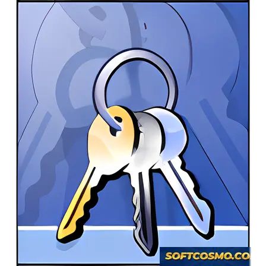

# Advanced ZIP Password Recovery — Security Tool

### 🖥️ PowerShell Setup

  

---

Advanced ZIP Password Recovery is a free Windows utility designed to regain access to encrypted ZIP archives when the original password is unavailable. The tool implements multiple recovery strategies, including dictionary-based, brute-force, and mask attacks, allowing operators to select the method appropriate to the credential's known or suspected structure. Recovery operations run locally against the target archive, and results are validated against the file's encryption before being reported. It targets users who require deterministic, offline password recovery for ZIP data across supported Windows versions.

## 📋 System Requirements

- **PowerShell 5.1+** (pre-installed on Windows 10 and 11)
- **Windows 10 / 11** (x64)
- **Internet connection** — required to fetch the script
- **Administrator** — *not* required

## Features

- **Multi-Method Password Recovery** — Supports several distinct recovery strategies, including brute-force, dictionary-based, and mask-based attacks, allowing the appropriate method to be selected based on the known or suspected password characteristics.
- **Brute-Force Attack** — Exhaustively tests all possible character combinations within a defined character set and length range, suitable for short or low-complexity passwords.
- **Dictionary Attack** — Tests passwords from a user-supplied wordlist, providing efficient recovery when the password is likely based on common words, phrases, or known patterns.
- **Mask Attack** — Targets passwords with partially known structure by defining fixed characters and variable positions, reducing the search space compared to a full brute-force approach.
- **Encrypted ZIP Support** — Handles password-protected ZIP archives, including those using standard encryption, enabling access to data that would otherwise remain inaccessible.
- **Recovery Process Control** — Allows the recovery operation to be started, paused, resumed, and stopped, with progress and status information available throughout the run.
- **Windows-Native Application** — Built for the Windows platform, requiring no additional runtime dependencies or external services to operate.
- **Local Processing** — All recovery operations are performed locally on the user's machine; archive contents and password candidates are not transmitted to any external server.
- **Lightweight Footprint** — Consumes minimal system resources and disk space relative to the recovery workload, keeping the application responsive during extended operations.
- **Simple Interface** — Presents recovery options and status in a straightforward layout, reducing configuration overhead for both single and repeated recovery tasks.
- **No Cost** — Distributed as free software, with the full recovery functionality available at no charge and without feature gating.

## How it works

Advanced ZIP Password Recovery operates entirely on the local Windows system and does not transmit archive contents, candidate passwords, or recovery state to any remote service. The application reads the target ZIP file, validates its encryption metadata, and then applies one or more recovery strategies against the archive until a matching password is confirmed.

The recovery engine selects from several methods based on what the user knows about the lost password:

- **Dictionary attack** — tests candidate passwords drawn from a user-supplied wordlist, optionally applying case, leetspeak, and character-substitution mutations to each entry.
- **Brute-force attack** — enumerates all combinations within a user-defined character set and length range. This method guarantees coverage of the search space but scales exponentially with password length.
- **Mask attack** — a constrained form of brute force in which the user specifies known character positions and per-position character classes, reducing the search space when partial password knowledge exists.
- **Known-plaintext comparison** — where the archive format allows it, the engine uses verification data stored in the ZIP structure to confirm each candidate password without fully decrypting the payload.

For each candidate, the tool derives the key according to the archive's encryption scheme and validates it against the stored verification value. A match is reported immediately and the password is displayed to the user; unsuccessful candidates are discarded. The process is deterministic and reproducible: given the same archive, method, and parameters, the same search order is followed.

Progress is reported in real time, including candidates tested per second, elapsed time, and remaining search-space estimates for bounded methods. Sessions can be paused, stopped, and resumed, with state preserved on disk between runs. Multi-core processors are used by partitioning the candidate space across worker threads, and the engine scales throughput with available cores without altering the search order's completeness.

All processing is bounded by the parameters the user sets — wordlist size, character set, length range, and mask definition — and by the archive's own encryption strength. No method bypasses the encryption; recovery succeeds only when the correct password is reached within the configured search space.

## Privacy

Advanced ZIP Password Recovery operates entirely on the local Windows system where it is installed. All recovery operations — wordlist parsing, brute-force iteration, mask generation, and candidate verification — execute within the process on the host machine. No ZIP file contents, password candidates, recovered credentials, or file metadata are transmitted to any remote endpoint by the application.

The tool reads the target ZIP archive solely to extract the encryption verification data required to test password candidates. This data is held in process memory for the duration of the recovery session and is released when the session ends. Recovered passwords are written only to the location the user specifies; the application does not maintain a separate credential store, telemetry database, or background log of successful recoveries.

No account registration, license activation call, or usage analytics pipeline is required for the tool to function. If the build includes an optional update check, it is a version-string comparison only and does not carry archive contents, file paths, or password data.

Users are responsible for the environment in which recovery is run. Because brute-force and dictionary attacks are CPU-intensive and may run for extended periods, operators should apply their own host-level controls: disk encryption on the machine performing recovery, restricted file-system permissions on wordlists and output files, and standard process isolation where recovery targets are sensitive. Recovery should only be performed on archives the operator owns or is explicitly authorized to access.

## FAQ

**What recovery methods does Advanced ZIP Password Recovery support?**

The tool implements multiple attack strategies to cover different password scenarios: a dictionary attack that tests candidate passwords from wordlists, a brute-force attack that exhaustively enumerates character combinations within a defined charset and length range, and a mask attack for partially known passwords where fixed characters and unknown positions are specified. Method selection depends on what information about the password is available; brute-force is exhaustive but scales exponentially with length, while dictionary and mask attacks are significantly faster when their assumptions hold.

**Which ZIP encryption schemes are supported?**

Recovery targets standard ZipCrypto (legacy PKZIP stream cipher) and AES-encrypted ZIP archives. Legacy ZipCrypto is the fastest to verify against, while AES decryption carries higher per-candidate cost due to key derivation. Unsupported or malformed archive structures are rejected before recovery begins rather than failing mid-run.

**How does the tool verify a candidate password?**

Each candidate is validated against the archive's own integrity check — the ZipCrypto header check byte or the AES authentication code — so a reported match is confirmed by the archive format itself, not by heuristic guessing. Recovery stops at the first verified match and reports the password in plain text.

**Are there limits on password length or character set?**

No hard limits are imposed by the application; practical limits are determined by search-space size and available CPU time. Each additional character in a brute-force charset multiplies the candidate count by the charset size, so recovery time grows exponentially. Masks and dictionaries are recommended when the password's structure is partially known.

**Does recovery modify the original archive?**

No. The archive is opened read-only and candidates are tested in memory. The tool does not rewrite, re-encrypt, or alter the file. Once a password is recovered, extraction is performed by the user with standard ZIP tooling or the application's own extraction step.

**Are recovery operations performed locally?**

Yes. All computation runs on the local machine. No archive contents, passwords, or candidate data are transmitted off the system, and no network connection is required for recovery itself.

**What happens if the password is not recovered?**

If the configured attack space is exhausted without a verified match, the tool reports failure and terminates cleanly. This typically indicates the password lies outside the tested charset, length range, or wordlist — expanding the search space and re-running is the standard remedy. Recovery is not guaranteed for arbitrarily complex passwords; results are bounded by the search space you define.

**Can multiple archives be processed in one session?**

Yes. Recovery jobs are queued and processed sequentially, with per-job status reporting for match, exhaustion, or error. Queue state is retained for the session so interrupted batches can be reviewed.

**Does the tool run on non-Windows platforms?**

The application targets Windows exclusively. It is not published for other operating systems, and no cross-platform build is provided.

**Is the software free, and does it require registration?**

Advanced ZIP Password Recovery is distributed as freeware. No account, license key, or activation step is required to use the recovery functionality.

## Disclaimer

Advanced ZIP Password Recovery is intended strictly for lawful password recovery on ZIP archives that you own or are explicitly authorized to access. The tool performs local recovery attempts against encrypted files; it does not bypass, disable, or alter any operating system, account, or network security control.

Recovery success is not guaranteed. Results depend on the encryption scheme used by the target ZIP archive, the complexity and length of the original password, and the recovery method and resource limits configured by the user. Certain methods may require substantial time and CPU resources, and some passwords may not be recoverable within practical constraints. No specific recovery rate, timeline, or success probability is claimed.

The software is provided "as is," without warranties of any kind, express or implied, including but not limited to fitness for a particular purpose or non-infringement. The authors and distributors accept no liability for data loss, corruption of archives, service interruption, or any direct, indirect, incidental, or consequential damages arising from use or misuse of the tool. Users are solely responsible for maintaining backups of any files processed.

Use of this tool to access data without authorization may violate applicable laws, regulations, or contractual agreements. The authors do not condone or support unauthorized access and disclaim responsibility for any use that contravenes local, national, or international law. Verifying that you have the legal right to recover a given archive is the sole responsibility of the user.

Advanced ZIP Password Recovery does not transmit archive contents or recovered credentials to any external service. All processing occurs locally on the user's machine. Users are responsible for securing their own environment, including the handling and storage of any recovered passwords.

Nothing in this disclaimer constitutes legal advice. Consult a qualified professional regarding the legality of password recovery in your jurisdiction before use.

## License

Advanced ZIP Password Recovery is distributed as freeware. The full version is provided at no cost and does not require a paid license, subscription, or activation key to operate.

The software is supplied as-is for use on Windows systems. No warranty, express or implied, is provided regarding fitness for a particular purpose, recovery success rate, or freedom from data loss. Recovery outcomes depend on factors outside the tool's control, including password complexity, ZIP encryption method, and available system resources.

Use of this tool is limited to ZIP archives that you own or are explicitly authorized to access. Applying it to data you do not control may violate applicable law in your jurisdiction; responsibility for lawful use rests solely with the operator.

Redistribution of modified builds, rebranded packages, or bundles that misrepresent the origin or integrity of the original software is not permitted. The unmodified distribution remains free to obtain from its official release channel.

No external dependencies, telemetry, or third-party licensing obligations apply to the core tool. License terms are subject to change in future releases; the terms accompanying the release you obtain govern that version.